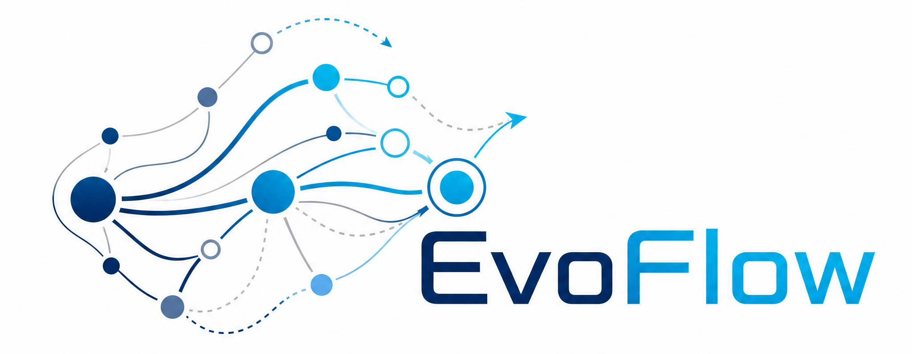

<p align="center">
  
</p>

> 本版本已完成 Windows 全量回归、发布接口及 Ubuntu WSL 构建与便携接口验证。

# EvoFlow

EvoFlow 是一个面向组合优化与连续优化的 C++17 演化计算平台。它把问题建模、优化器装配、运行评估和统计分析分离，并通过注册式组件目录组合拓扑、策略、生成器、评价器与选择器。

当前公开产品版本为 **3.0.1.5**。配置文件的 `v3.1/v3.2` 以及结果、过程文件的格式版本是独立协议版本，不随产品版本改写。

## 支持范围

| 能力 | 当前验证范围 |
|---|---|
| Windows 命令行、图形界面、模型连接 | Windows x64 |
| Windows Python 预编译包 | Windows x64，64 位 CPython 3.8–3.12 |
| Linux C++ 核心与命令行 | 已在 Ubuntu 24.04.4 WSL2 x86_64、GCC 13.3、CMake 3.28.3、Ninja 1.11.1 完成源码构建与运行验证；不提供 Linux 预编译发布包 |
| Linux Python 接口 | 已在上述环境以 CPython 3.12.3 完成源码构建和可移植测试；不提供 Linux 预编译模块，也不承诺跨 Python 小版本二进制兼容 |
| Linux 图形界面和模型连接 | 当前不支持 |
| macOS | 未验证，不作支持承诺 |

## 快速开始

在 Windows 上双击 `evoflow.exe`，或在项目目录执行：

```text
evoflow
```

程序会启动本地服务并打开图形界面，可用于定义或加载问题、构筑优化器、运行当前配置以及分析实验结果。

命令行运行单个问题与配置：

```text
evoflow run <问题文件> <配置文件>
```

查看产品版本：

```text
evoflow --version
```

检查最小/完整数据包：

```text
evoflow data
python -m evoflow --check-data
```

完整参数见 [可执行程序手册](docs/手册/13-使用-可执行程序.md)。

## Windows 发布资产

Windows x64 发布提供三个相互独立但可组合的 ZIP：

- `EvoFlow-3.0.1.5-windows-x64.zip`：程序、公开 C++/Python 源码、五个 CPython 3.8–3.12 原生模块、配置、教程、文档和 13 个首方最小样例；
- `EvoFlow-3.0.1.5-data-minimal.zip`：可单独取得的同一组 13 个首方样例；
- `EvoFlow-3.0.1.5-data-full.zip`：701 个许可状态明确的额外实例 overlay。

每个 ZIP 都有同名 `.sha256`。程序包解压后可直接运行 `evoflow.exe`；需要完整数据时，再把 full ZIP 解压到同一目录。正式程序树带 `release-manifest.json`，记录除 manifest 自身外每个文件的字节数和 SHA-256。

## 文档

- [项目总览](docs/手册/00-总览.md)
- [图形界面](docs/手册/14-使用-图形界面.md)
- [Python 接口](docs/手册/15-使用-Python接口.md)
- [问题模块](docs/手册/10-使用-问题模块.md)
- [优化器配置](docs/手册/11-使用-优化器配置.md)
- [结果分析](docs/手册/12-使用-结果分析.md)
- [数据包与外部数据](docs/数据包与外部数据.md)
- [EvoFlow 3.0.1.5 发布日志](发布日志.md)
- [未来更新计划](未来更新计划.md)
- [源码构建入口](build/README.md)
- [开发架构与流程](docs/手册/20-开发-架构与流程.md)
- [完整用户手册索引](docs/手册/README.md)

## 从源码构建

```text
cmake -S . -B obj-cmake-release
cmake --build obj-cmake-release --config Release
```

也可以使用 `build/cmake/` 入口，或在 Visual Studio 2022 中打开 `build/vs/evoflow.sln`；详细说明见 [源码构建入口](build/README.md)。`build/` 保存可发布的工程入口，生成文件应放在可删除的 `obj-*` 目录。

Windows 发布候选由独立干净暂存树通过 Visual Studio 2022/CMake 构建；`evoflow.exe` 使用 `/MT`，不要求另装 VC++ 可再发行运行时。Python 不加入 CMake，预编译模块仍由独立 Python 构建入口生成。

发布目录中的 `figs/Logo.png` 供图形界面使用；README 使用由同一原图纯裁剪生成的 `figs/Logo-readme.png`，仅去除上下空白。移动 `evoflow.exe` 时，请保留同级 `figs` 目录。

## 许可与外部组件

EvoFlow 自有源码采用 [BSD 3-Clause License](LICENSE)。外部组件的版本、版权及许可证见 [THIRD_PARTY_NOTICES.md](THIRD_PARTY_NOTICES.md)。

自 `v3` 起，源码树、构建、公开 API 和发布物均不包含 CEC2013 竞赛基准。用户如已自行合法取得外部 benchmark，可通过 [`tutorial/7.external-benchmark.cpp`](tutorial/7.external-benchmark.cpp) 的 C++ functor 边界或 [`python/examples/external_benchmark.py`](python/examples/external_benchmark.py) 的 Python callable 接入；现成 `evoflow.exe`/图形界面不会动态加载任意外部原生库。
